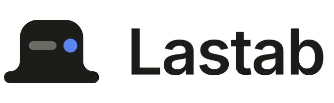

<p align="center">
  <picture>
    <source media="(prefers-color-scheme: dark)" srcset="design/brand/lastab-horizontal-reversed.svg">
    
  </picture>
</p>

<p align="center"><b>Back to the last tab.</b><br>A scratch pad for plain text that opens as fast as ⌘N in Sublime Text and keeps everything you type.</p>

<p align="center">English · <a href="README.zh-CN.md">简体中文</a></p>

---

Lastab is a resident desktop app for plain-text snippets, on macOS and Windows. Press ⌘N for a blank snippet, paste something in, change part of it and copy it back out. You never name, file or save anything. Every snippet is kept in the background, so you can find it again later by time, title or text, even after you've closed it.

## Features

- **Instant new snippet**: ⌘N / Ctrl+N opens a blank editor straight away, with nothing to name or file first.
- **Kept automatically**: snippets save as you type and come back after a crash. Closing a snippet doesn't delete it.
- **Titles made on your device**: titles come from the content and are list metadata only. They never go into the text or get copied out with it.
- **Recent switcher**: ⌘\` / Ctrl+\` switches between open snippets; press the shortcut, then Return, to go back to the last one.
- **Full-text search**: ⌘K / Ctrl+K searches every snippet, closed ones included. It uses SQLite FTS5 with the trigram tokenizer, so Chinese, English and code symbols all match on any substring.
- **Version history**: see what changed in a snippet and restore an earlier version, then undo the restore if you need to.
- **To-do lists**: ⌘T / Ctrl+T opens a new list, stored as plain `- [ ]` text. Pasting several lines makes one item per line.
- **Copy all**: ⌘⇧C / Ctrl+Shift+C copies the whole snippet with line endings, tabs and full-width characters kept as they are.
- **Agent access**: a `lastab` command and a Claude Code skill let agents search and read your snippets, and, if you allow it, rename their titles. Off by default, with likely secrets masked by default.
- **Dark mode and languages**: light, dark or follow the system; English and Simplified Chinese; a custom accent color.

## Install

Download from [Releases](https://github.com/momaek/lastab/releases):

| Platform | File | Notes |
| --- | --- | --- |
| macOS 12+ | `lastab-<version>.dmg` | Universal (Apple silicon and Intel) |
| Windows 10 / 11 | `lastab-setup-<version>-amd64.exe` / `-arm64.exe` | Installs per user to `%LOCALAPPDATA%\Programs\Lastab`, no admin rights needed |

Unsigned builds are blocked by Gatekeeper on macOS and get a SmartScreen warning on Windows.

## Shortcuts

| Action | macOS | Windows |
| --- | --- | --- |
| New text snippet | ⌘N | Ctrl+N |
| New to-do list | ⌘T | Ctrl+T |
| Show Lastab and start a new snippet (global) | ⌃⌥N | Ctrl+Alt+N |
| Recent switcher | ⌘\` | Ctrl+\` |
| All snippets and search | ⌘K | Ctrl+K |
| Copy all | ⌘⇧C | Ctrl+Shift+C |
| Version history | ⌘Y | Ctrl+Shift+Y |
| Show / hide sidebar | ⌘\\ | Ctrl+\\ |
| Close snippet | ⌘W | Ctrl+W |
| To-do: check / move / delete | ⌘↵ / ⌥↑↓ / ⌘⇧⌫ | Ctrl+Enter / Alt+↑↓ / Ctrl+Shift+Backspace |

Hold ⌘ (Ctrl on Windows) for about half a second to see the shortcuts on screen. In lists, hold ⌥ / Alt to see exact times. You can change any shortcut in Settings.

## For agents

In **Settings → Agent access**:

1. Turn on **Allow agent access**. It's off by default, and while it's off the command prints nothing.
2. Click **Install** on the **Command-line tool** row. On macOS this links `lastab` into `/usr/local/bin`, or `~/.local/bin` if that isn't writable. On Windows it adds the app's `bin` folder to your user PATH.
3. Click **Install skill** to write `~/.claude/skills/lastab/SKILL.md`.

Then ask Claude Code something like "find the curl I was editing yesterday". Other agents can call the command directly; it always prints JSON:

```bash
lastab search "orders" --since 1d --client my-agent
lastab list --open --kind todo
lastab read 01JD2F9C          # an ID or a unique prefix
lastab retitle 01JD2F9C "Staging orders repro"
lastab status
```

**Mask likely secrets** is on by default: `Authorization`, `Bearer`, `api_key` and similar come out as `••••••••`. It can only be turned off in Settings; agents can't bypass it with a flag. Every read is recorded, and you can review them under **Access log** in Settings.

The command can only read, except for `retitle`, which renames a snippet's title and works only after you turn on **Let agents rename titles** (off by default). It never changes the text, and never renames a title you named yourself. Each rename appears in the access log with **Undo**.

Exit codes and the error format are in [`skill/SKILL.md`](skill/SKILL.md).

## Data

Everything stays on your machine. Nothing is synced.

| Platform | Location |
| --- | --- |
| macOS | `~/Library/Application Support/Lastab/` |
| Windows | `%LOCALAPPDATA%\Lastab\` |

`lastab.db` holds snippets, versions and settings; `agent_log.db` holds the agent access log. The development build uses a separate `Lastab Dev` folder.

## Development

The whole project is Go. The desktop framework is [MyGo](https://github.com/egoist/mygo), using its native UI (drawn with Metal on macOS and Direct3D 11 on Windows), so there's no WebView, Node or C compiler involved.

You need Go 1.27.4. The MyGo CLI is pinned in `go.mod` as a Go tool.

```bash
go tool mygo doctor
```

```bash
go run ./scripts/build -cli-only
```

```bash
go tool mygo dev
```

```bash
go test ./...
```

In order, these check your environment; build the `lastab` command for this machine (the development build's Agent access page uses it); start "Lastab Dev", which restarts when you change a `.go` file; and run every test, including the headless view tests.

The project calls native code through purego, so build with `CGO_ENABLED=0`.

### Generated files

After changing `design/tokens.json` or `locales/*.json`, regenerate the matching files (CI checks that they're up to date):

```bash
go run ./scripts/gentokens
```

```bash
go tool mygo generate
```

### Packaging

```bash
go run ./scripts/build -platform darwin/universal
```

```bash
go run ./scripts/build -platform windows/amd64,windows/arm64
```

Builds land in `build/<platform>/`. Signing and notarization are turned on with environment variables (see [`scripts/build/main.go`](scripts/build/main.go)). Without them the macOS app is signed ad hoc and the Windows build isn't signed. Building the Windows installer on a Mac needs `brew install makensis` first.

### Releasing

Set the new `version` in `mygo.json`, merge it into `main`, then push a matching tag:

```bash
git tag v0.1.2 && git push origin v0.1.2
```

[`release.yml`](.github/workflows/release.yml) builds the macOS DMG and the Windows installers and uploads them to a draft release, which you publish after checking it.

### Layout

| Path | Contents |
| --- | --- |
| `main.go` | Desktop app entry point |
| `cmd/lastab/` | The `lastab` command: reads, plus `retitle` when allowed |
| `internal/store/` | SQLite storage, migrations and FTS5 search |
| `internal/snippet/` | Snippets, workspace and crash recovery |
| `internal/ui/` | All screens and interaction |
| `internal/title/`, `history/`, `todo/`, `redact/` | Automatic titles, version history, to-do parsing, secret masking |
| `internal/install/` | Installing the command and the skill |
| `locales/` | UI strings (`en`, `zh-Hans`) |
| `design/` | Design canvas, design tokens and brand marks |
| `skill/` | The Claude Code skill shipped with the app |
| `scripts/` | Build, icon and token generation |

### Docs

The design docs are in Chinese:

- [Requirements](docs/requirements/Lastab-需求说明-v0.5.md)
- [Development guide](docs/requirements/Lastab-开发文档-v0.1.md): architecture, storage, module design, platform differences
- [Development plan](docs/requirements/Lastab-开发计划-v0.1.md)
- [Acceptance checklist](docs/acceptance.md)
- [UI design](design/README.md) and [brand marks](design/brand/README.md)
