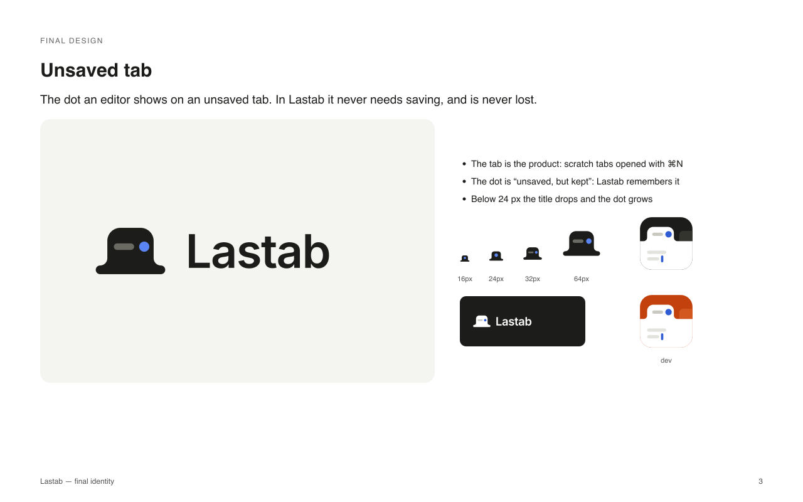

# Lastab 标志

## 想法

一个标签页，标签上有一个蓝色圆点。

编辑器里没保存的 tab 会在标签上标一个圆点，关掉就没了。Lastab 的用户就是这样用 Sublime 的：⌘N 开一个空白 tab，贴进 curl 或 JSON，改一段再复制走，从来不存。在 Lastab 里，这个圆点不再是警告：tab 不用存，也不会丢。

- **标签页**是产品本身：一排随手开的临时 tab。
- **圆点**是「没存，但留着」：Lastab 替你记住了它。
- **应用图标**把这个标签放回窗口：深色的标签栏里打开一个 tab，下面是正在写的那页，光标停在最后一行。

真实场景里的效果见 [board-in-use.png](board-in-use.png)。

## 文件

全部 SVG 都由 [`gen.mjs`](gen.mjs) 生成（`node design/brand/gen.mjs`），都是轮廓化的路径，没有 `<text>`，不依赖字体。不要手改 SVG，改 `gen.mjs` 里的常量再生成。

| 文件 | 用途 |
| --- | --- |
| `lastab-horizontal-{color,reversed,black,white}.svg` | 主标志（横版），README、网页、发布说明 |
| `lastab-stacked-{color,reversed,black,white}.svg` | 竖版，空间接近正方形时用 |
| `lastab-symbol-{color,reversed,black,white}.svg` | 只用图形，头像、24 px 及以上 |
| `lastab-symbol-small-{color,reversed,black,white}.svg` | 小尺寸图形：去掉标题条，圆点放大，24 px 以下用 |
| `lastab-wordmark-{color,reversed}.svg` | 只用字标，图形已在附近出现时用 |
| `lastab-app-icon.svg` / `lastab-app-icon-dev.svg` | 应用图标母版（1024，macOS 图标网格） |

`color` 用在浅色背景上，`reversed` 用在深色背景上，`black` / `white` 用于只能单色的场合（标题条和圆点镂空）。

`gen.mjs` 同时写出应用界面里用的两份 SVG，放在 `internal/ui/brand/`，由 [`internal/ui/brand.go`](../../internal/ui/brand.go) 嵌入。标签和字标用 `currentColor`，跟随界面文字色；圆点保持品牌蓝，随外观切换深浅。

| 位置 | 用的标志 |
| --- | --- |
| 侧栏顶部，窗口模式（macOS 红绿灯在左侧） | 只用图形，30 pt |
| 侧栏顶部，全屏或 Windows | 横版，24 pt |
| 设置 → 关于 | 横版，36 pt |

应用和托盘图标的 PNG 由 `go run ./scripts/genicon` 生成，几何与 `gen.mjs` 相同：

| 输出 | 尺寸 | 说明 |
| --- | --- | --- |
| `resources/icon.png` | 1024 | 正式版：墨色标签栏、白色页面、蓝色圆点与光标 |
| `resources/icon-dev.png` | 1024 | 开发版：标签栏换成开发橙 |
| `internal/shell/assets/tray-template.png` | 36 | macOS 菜单栏模板图（18 pt @2x），黑色、标题条和圆点镂空，由系统着色 |
| `internal/shell/assets/tray-win.png` | 32 | Windows 通知区域，墨色底、白色标签、蓝色圆点（小尺寸图形） |

## 构造

### 图形（256 网格）

- 内容框 192 × 128：x 32 到 224，y 64 到 192，中心在 (128, 128)。
- **标签栏**：y 168 到 192，厚 24，两端为半圆。
- **标签**：x 64 到 192，顶边 y 64，顶角半径 36；与标签栏交接处是半径 20 的内凹圆角，像浏览器标签的「脚」。
- **标题条**：(82, 107) 起，56 × 18 的胶囊。
- **圆点**：圆心 (166, 116)，半径 14。
- **小尺寸图形**：去掉标题条，圆点移到 (128, 116)，半径 24。

### 应用图标（1024 网格）

- 底板 100 到 924，圆角 185。y 476 以上是标签栏（墨色），以下是页面（白色）。
- 当前标签：x 212 到 632，顶边 y 252，顶角 96，脚的圆角 56，与页面连成一体。
- 右侧露出半个未激活的标签（`#34342F`），顶边 y 316，圆角 60。
- 标签上：标题条 (292, 342) 170 × 52，圆点圆心 (548, 368) 半径 50。
- 页面上：两行文字 300 与 190 宽、52 高，第二行末尾是光标 36 × 108。

改动图形时，`gen.mjs` 和 `scripts/genicon/main.go` 里的常量要一起改。

## 颜色

| 名称 | HEX | RGB | 用途 |
| --- | --- | --- | --- |
| 墨色 Ink | `#1C1C1A` | 28 28 26 | 标签（浅底）、应用图标标签栏、字标 |
| Lastab 蓝 | `#2F5BD3` | 47 91 211 | 圆点与光标（白底），即界面强调色 |
| 亮蓝 | `#5B85F2` | 91 133 242 | 圆点（墨色标签上） |
| 纸色 | `#F4F4F1` | 244 244 241 | 展示用浅底 |
| 标题灰 | `#6A6A63` / `#C9C9C2` | 106 106 99 / 201 201 194 | 标题条，分别在墨色与白色标签上 |
| 开发橙 | `#C2410C` | 194 65 12 | 仅开发版图标 |

对比度：亮蓝对墨色 4.9:1，Lastab 蓝对白色 5.9:1。

允许的组合：浅底用 `color`，墨色或深底用 `reversed`，Lastab 蓝底用 `white`，单色印刷用 `black`。

## 字标

- 字体是 Inter SemiBold（SIL OFL，可用于标志），字距 −2%，已转成轮廓。
- 不要直接打字重排字标，用 SVG 文件。

## 留白与最小尺寸

- **留白**：四周至少留一个标签栏的厚度（24，约为图形宽度的 1/8）。
- **最小尺寸**：

  | 版本 | 屏幕最小 |
  | --- | --- |
  | 横版 | 宽 96 px |
  | 竖版 | 宽 64 px |
  | 图形 | 24 px；更小用 `symbol-small` |

## 不要

- 拉伸、旋转，或把标签倒过来。
- 把圆点换成别的颜色，或去掉圆点：没有圆点就只是一个普通的 tab。
- 加阴影、描边、渐变。
- 把图形和字标拆开重排，或改变两者的比例。
- 放在杂乱背景上而不加底色。
