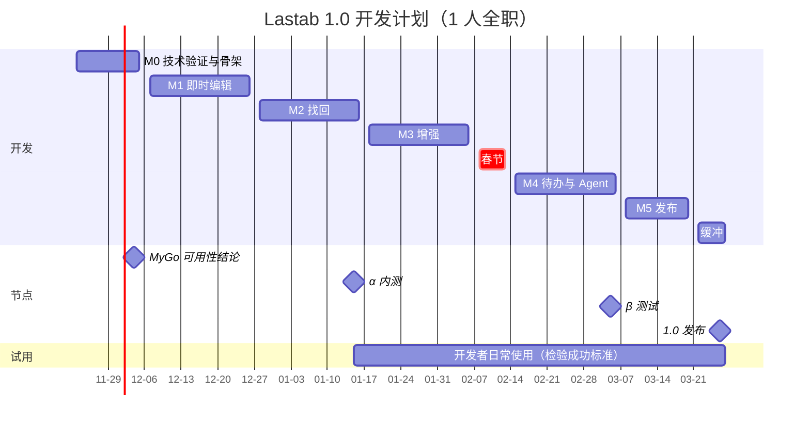

# Lastab：开发计划 v0.1

2026-11-18

根据 [开发文档 v0.1](Lastab-开发文档-v0.1.md) 的里程碑（M0–M5），排出到 1.0 发布的整体计划：每个阶段做什么、交付什么、何时验收，以及待确认问题需要在什么时候定下来。

## 计划前提

| 项 | 假设 |
| --- | --- |
| 人力 | 1 名全职 Go 开发（配合 Claude Code 等工具）。两人的排法见「其他排法」 |
| 开工 | 2026-11-23（周一） |
| 范围 | 1.0 包含需求中的 P0 与 P1，含待办清单与 Agent 访问（需求待确认问题 5 尚未定；不含这两项的排法见「其他排法」） |
| 平台 | macOS 与 Windows 同时发布（需求待确认问题 9 尚未定） |
| 节假日 | 元旦 2027-01-01（周五）；春节按 2027-02-08 至 02-12 一周不排任务（以国务院公布的 2027 年放假安排为准） |
| 估算单位 | 人周。每个阶段的估算已包含该阶段的测试与修复；另在最后留 1 周整体缓冲 |

## 总览

| 阶段 | 日期 | 周数 | 主要内容 | 阶段结束时 |
| --- | --- | --- | --- | --- |
| M0 技术验证与骨架 | 2026-11-23 → 12-04 | 2 | 11 项技术验证、工程骨架、CI、主题与多语言骨架 | 定下 MyGo 是否可用 |
| M1 即时编辑 | 2026-12-07 → 12-25 | 3 | 多 tab 编辑器、文本保真、自动留存、异常恢复、复制全部、常驻与全局热键、深浅色、中英文 | 可以替代 Sublime 做中转编辑（不含找回） |
| M2 找回 | 2026-12-28 → 2027-01-15 | 3（元旦少 1 天） | 自动标题、「最近」切换器、⌘K 列表与全文搜索 | **α 内测**：开发者自己日常使用 |
| M3 增强 | 2027-01-18 → 02-05 | 3 | 版本历史、快捷键自定义、标题手改、遮蔽、时间过滤、设置页补全 | P1 中与编辑、找回相关的部分完成 |
| 春节 | 2027-02-08 → 02-12 | — | 不排任务 | — |
| M4 待办与 Agent | 2027-02-15 → 03-05 | 3 | 待办清单；`lastab` 命令行、Skill、访问开关与记录 | **β 测试**：签名版发给测试用户（两个平台） |
| M5 发布 | 2027-03-08 → 03-19 | 2 | 签名、公证、安装包、发布流水线、逐条验收、性能对比、修复 | 发布候选版 |
| 缓冲 | 2027-03-22 → 03-26 | 1 | 处理超期与验收遗留问题 | **1.0 发布** |

合计：16 个工作周 + 春节 1 周，**1.0 目标日期 2027-03-26**。

## 分阶段计划

### M0 技术验证与骨架（2026-11-23 → 12-04，2 周）

| 周 | 任务 |
| --- | --- |
| 第 1 周 | 用 `go tool mygo init -template native` 生成骨架；搭好仓库结构、`mygo.json`、CI（macOS + Windows：lint、test、i18n check）；`scripts/gentokens` 生成主题颜色；最小原型：常驻窗口 + 一个编辑器 tab + 全局热键 |
| 第 2 周 | 跑完开发文档第 12 节的技术验证：呼出速度、⌘\`、编辑器行尾与粘贴、智能替换、中文输入法、FTS5 trigram 与只读 WAL、1 万条搜索延迟、切换器接管 Tab、运行时切换语言与外观、中英混排、Skill → CLI 链路（可用假数据） |

**交付**：可运行的骨架与原型；技术验证结论写回开发文档第 12 节。

**验收（决策点）**：

- 呼出速度、文本保真、中文输入法三项必须通过；任何一项不通过且没有备选办法时，重新评估框架（会推迟整体计划，最坏约 2–3 周）。
- 其余各项不通过时，按开发文档中的备选方案处理，计划不变。

### M1 即时编辑（2026-12-07 → 12-25，3 周）

| 周 | 任务 |
| --- | --- |
| 第 3 周 | `internal/store`：表结构、迁移、WAL、读写分离；`internal/snippet`：新建、空白判定、保存（防乱序）、关闭；标题栏与 tab 栏（两个平台的窗口按钮） |
| 第 4 周 | 编辑器配置与文本保真（行尾、粘贴、无自动补全、等宽字体）；自动留存与状态栏（正在留存 / 已留存 / 留存失败与重试）；复制全部（按钮原地确认）；`session.lock` 异常恢复 |
| 第 5 周 | 常驻后台、单实例、托盘、全局呼出热键、应用菜单与快捷键表；深浅色主题（`tokens.json` 全部颜色）、中英文消息目录、中英混排细空格；本阶段视图测试与保真测试 |

**交付**：能新建、粘贴、修改、复制、自动留存的多 tab 编辑器，两个平台都可运行。

**验收**：

- 需求「验收行为」中以下几项通过：新建速度、新建无前置步骤、复制只含正文、文本逐字节一致、空白不留空壳、异常退出后能恢复、深色无白屏、语言切换即时生效。
- 第一次做呼出速度与 Sublime 的实测对比，结果记入 [`docs/acceptance.md`](../acceptance.md)。

### M2 找回（2026-12-28 → 2027-01-15，3 周，元旦休 1 天）

| 周 | 任务 |
| --- | --- |
| 第 6 周 | `internal/title`：后台标题生成（curl、JSON、首行规则）；tab 与列表显示「未命名 · 时间」→ 标题；相对时间与具体时间（按住 ⌥） |
| 第 7 周 | 「最近」切换器：浮层、默认选中上一条、Tab / Shift+Tab / Enter / Esc、输入过滤、预览、连按快捷键 |
| 第 8 周 | `internal/search`：FTS5 trigram + 短查询回退；⌘K 全部片段与搜索：分组列表、筛选、命中高亮、预览面板、打开已关闭片段、删除确认；无结果状态 |

**交付**：完整的「编辑 → 离开 → 找回」闭环。

**验收**：

- 切换器两步内回到最近修改的片段；切换器只列已打开的 tab；已关闭的片段能被搜到；中文、英文、代码符号都能搜到；标题生成时仍可编辑和复制。
- **α 内测开始**：开发者在自己的机器上每天使用，记录问题；从这天起，开始检验「两周后不再用 Sublime 做中转编辑」这一成功标准。

### M3 增强（2027-01-18 → 02-05，3 周）

| 周 | 任务 |
| --- | --- |
| 第 9 周 | `internal/history`：快照时机（停顿、切换、关闭、复制、恢复前）、去重、改动统计；版本历史抽屉：版本列表、差异视图、恢复与撤销、只有一个版本 |
| 第 10 周 | `internal/redact`：规则与样本库，应用到列表、预览、切换器（含「显示」原文）；标题手动修改；时间过滤 |
| 第 11 周 | 设置页补全：外观、语言、强调色、按住 ⌘ 提示、快捷键自定义（录制、冲突检测、恢复默认）、编辑字体；处理 α 内测发现的问题 |

**交付**：开发文档 M3 范围全部完成。

**验收**：修改旧片段后能从历史找回原内容；含 `Authorization` 的片段在列表中不显示明文；快捷键修改后立即生效。

### M4 待办与 Agent（2027-02-15 → 03-05，3 周）

| 周 | 任务 |
| --- | --- |
| 第 12 周 | `internal/todo` 解析与序列化；待办视图：⌘T 新建、Enter 新增、完成 / 排序 / 删除快捷键、勾选后沉底、清除已完成（可撤销）、粘贴多行拆分 |
| 第 13 周 | 待办：拖动排序与动效、自动标题（含进度）、进入列表 / 搜索 / 切换器；`cmd/lastab`：`list` / `search` / `read` / `status`、JSON 输出、退出码、只读打开、访问开关检查、遮蔽 |
| 第 14 周 | `agent_log.db` 与设置页「访问记录」；「安装命令行」与「安装 Skill」（含失败重试）；`SKILL.md`；用 Claude Code 跑通完整链路；`scripts/build` 把 CLI 打进应用资源 |

**交付**：开发文档 M4 范围全部完成；第一个签名的测试版。

**验收**：

- ⌘T 打开可输入的待办清单；待办自动留存并出现在列表与搜索中；Agent 能搜索并读取全部片段（含待办与随手记录）；关闭「允许 Agent 访问」后无法读取；默认输出遮蔽密钥。
- **β 测试开始**：签名、公证后的测试版发给 macOS 与 Windows 的测试用户。

### M5 发布（2027-03-08 → 03-19，2 周）

| 周 | 任务 |
| --- | --- |
| 第 15 周 | 发布流水线：Tag 触发构建、macOS 签名与公证、Windows 签名与安装包、Release 草稿；需求「验收行为」逐条过一遍，补齐缺的自动化测试 |
| 第 16 周 | 修复 β 测试反馈；两个平台的性能与找回对照测试（与 Sublime 对比）；发布说明、安装说明、Skill 使用说明 |

**交付**：1.0 发布候选版。

**验收**：[`docs/acceptance.md`](../acceptance.md) 中所有条目通过或有明确的豁免说明；两个平台的安装、升级、卸载流程走通。

### 缓冲（2027-03-22 → 03-26，1 周）

只处理超期任务与验收遗留问题，不加新功能。缓冲没用完就提前发布。

## 待确认问题的截止时间

待确认问题越晚定，返工越多。按影响的阶段排出截止时间：

| 截止 | 问题 | 影响 |
| --- | --- | --- |
| 2026-12-04（M0 结束） | 需求 1：全局呼出热键是否采用 | M1 第 5 周的热键实现 |
| | 需求 9：两个平台同时首发，还是先做一个 | 全部阶段的测试与发布工作量 |
| | 开发 1：最低系统版本 | CI 与测试机准备 |
| | 开发 5：MyGo 版本策略 | 升级节奏 |
| 2026-12-18（M1 第 2 周） | 需求 7、8：首发语言、是否只做浅色 / 深色 | M1 第 5 周的主题与消息目录 |
| | 需求 12：复制全部的入口与快捷键 | M1 第 4 周 |
| 2027-01-08（M2 第 2 周） | 需求 5：待办与 Agent 是否进入 1.0 | 决定按本计划还是「其他排法 B」 |
| | 需求 10、11：版本历史的粒度与保留、删除与清理策略 | M3 第 9 周 |
| 2027-02-05（M3 结束） | 需求 3、4：Agent 能否写入、访问默认开关、能否取得密钥原文 | M4 第 13–14 周 |
| | 需求 6：待办已完成项的处理 | M4 第 12 周 |
| 2027-03-05（M4 结束） | 开发 2、3、4：CLI 安装位置、是否开机自启、是否开启自动更新 | M5 的安装包与发布流水线 |

「需求 N」指需求说明 v0.5 的待确认问题 N，「开发 N」指开发文档 v0.1 第 14 节的第 N 条。

## 外部准备（需要提前办）

这些事情有等待时间，不在开发者的控制内，**M0 就开始办**：

| 事项 | 何时需要 | 说明 |
| --- | --- | --- |
| Apple Developer Program（Developer ID 证书） | M2 结束（α 之后给其他 Mac 试用）；最晚 M4 结束（β） | 以公司名义注册需要 D-U-N-S 编号，可能要 1–2 周以上 |
| 公证凭据（`notarytool` 钥匙串配置） | 同上 | 有了开发者账号后当天可配 |
| Windows 代码签名证书或 Azure Trusted Signing | M4 结束（β） | 身份验证可能要几天到几周；没有签名的安装包会被 SmartScreen 拦截 |
| 测试机 | M1 开始 | 至少一台 Windows（建议 Windows 11 + Windows 10 各一）；如支持 Intel Mac，再加一台 |
| 测试用户 | M4 结束 | β 测试 3–5 人，两个平台都要有 |

## 其他排法

### A：两人并行（1.0 约 2027-02-19）

业务层与界面分离，两人可以分两条线并行：

| 线 | 负责 |
| --- | --- |
| 界面线 | 标题栏与 tab、编辑器、切换器、⌘K 列表、版本历史界面、待办界面、设置页、主题与多语言 |
| 数据与发布线 | store、snippet、title、search、history、redact、todo 解析；`lastab` 命令行与 Skill；CI、签名、发布流水线 |

M0 仍需 2 周（技术验证不好拆）。之后的 15 人周（含缓冲）两人并行，因为联调、评审与发布不能完全拆开，按约 10 个工作周计，再加春节 1 周，1.0 约在 **2027-02-19**。前提：第二人在 M0 期间到位，并且两人在 M0 结束前约定好业务层 API（开发文档 5.1）。

### B：待办与 Agent 放到 1.1（1.0 约 2027-02-26，1.1 约 2027-03-26）

如果需求待确认问题 5 定为「待办与 Agent 不进首期」：M3 之后直接进入 M5，1.0 在春节后两周发布（**2027-02-26**，这一版不留单独缓冲）；M4 顺延为 1.1（2027-03-01 → 03-19），再加 1 周发布与缓冲，约 **2027-03-26**。这样 1.0 早一个月拿到真实反馈，代价是多走一次发布流程。

## 风险与应对

| 风险 | 对计划的影响 | 应对 |
| --- | --- | --- |
| M0 发现 MyGo 在编辑器保真、输入法或呼出速度上有阻断问题 | 最坏推迟 2–3 周（换框架或等上游修复） | M0 第 2 周优先验证这三项；有问题先向 MyGo 提 issue，同时评估 Web 前端方案作为退路 |
| MyGo 0.x 升级带来 API 变化 | 每次升级约 0.5–1 天 | 锁定版本，只在阶段之间升级 |
| macOS ⌘\` 无法接管 | 几乎无影响 | 默认改为 ⌃\`（需求已预留） |
| 待确认问题超过截止时间才定 | 相关阶段返工 | 按上表的截止时间逐项确认；未定的按建议默认先做 |
| 签名证书办理延误 | β 与发布延后 | M0 开始办理；没拿到之前用 ad hoc 签名在开发机上测试 |
| 单人开发，生病或其他工作插入 | 整体顺延 | 1 周缓冲；必要时按「其他排法 B」把待办与 Agent 移到 1.1 |

## 节奏

- **每周**：周五在两个平台各演示一次本周成果，更新本计划的进度与风险。
- **每个阶段结束**：按该阶段的「验收」逐项检查，结果记入 [`docs/acceptance.md`](../acceptance.md)；没通过的项要么修完再进入下一阶段，要么写明延后到哪个阶段。
- **计划调整**：日期变化超过 1 周，或范围变化（如采用其他排法 A / B），就更新本文档版本号。
